<div align="center">



<br/>

[](https://rabinr.in/)
[](https://www.linkedin.com/in/rabinr)
[](https://rabinr.in/contact)

</div>




```text
 +--------------------------------------------------------------+
 |  PANEL 1                                                     |
 |                                                              |
 |  NARRATOR:  Chennai, India. A developer, a keyboard, and     |
 |             an unreasonable amount of coffee.                |
 |                                                              |
 +--------------------------------------------------------------+
 |  PANEL 2                                                     |
 |                                                              |
 |  RABIN:   "I'm a Frontend Angular Consultant. 4+ years.      |
 |            Government, pension, insurance & healthcare       |
 |            platforms. Shipped in 3 countries."               |
 |                                                              |
 +--------------------------------------------------------------+
 |  PANEL 3                                                     |
 |                                                              |
 |  RABIN:   "My mission? Angular apps that are fast,           |
 |            accessible, and still easy to change by          |
 |            the THIRD release."                               |
 |                                                              |
 |                                        *KEYBOARD CLACKING*   |
 +--------------------------------------------------------------+
```

> **Currently:** building enterprise healthcare apps with **Angular 22, TypeScript, SCSS and Angular Signals** as a Frontend Angular Consultant at RSTACK Solutions.
> **Open for:** remote and contract work: Angular architecture, performance and migration for government and enterprise teams.

<table>
<tr>
<td align="center" width="25%"><h1>4+</h1><b>YEARS</b><br/>of production Angular</td>
<td align="center" width="25%"><h1>3</h1><b>COUNTRIES</b><br/>Fiji / Vanuatu / India</td>
<td align="center" width="25%"><h1>6</h1><b>CASE STUDIES</b><br/>live on my portfolio</td>
<td align="center" width="25%"><h1>100</h1><b>LIGHTHOUSE</b><br/>accessibility + SEO</td>
</tr>
</table>




**POW!** My daily-driver toolkit:

<p>
  
</p>

| POWER | LEVEL | SIDEKICK MOVES |
| :-- | :-- | :-- |
| **Angular** | Daily, in production | Standalone components, Signals, Zoneless, SSR with hydration |
| **TypeScript** | Daily, in production | Strict typing, clean architecture, reusable patterns |
| **RxJS** | Daily, in production | Shared stream patterns that cut duplicate API calls |
| **Ionic + Capacitor** | Shipped to stores | iOS and Android from one Angular codebase, biometrics, offline |
| **NestJS** | Working knowledge | REST APIs and backend-for-frontend layers |
| **Tailwind / SCSS** | Daily | Design systems and accessible UI |

**Keywords I live by:** `Angular` / `TypeScript` / `JavaScript` / `RxJS` / `Angular Signals` / `Frontend Development` / `Web Development` / `Ionic` / `NestJS`




### FEATURED GITHUB ISSUES

| ISSUE | WHAT'S INSIDE | TECH |
| :-- | :-- | :-- |
| **#1 [Zelavora Nexus](https://github.com/rabinrdev/zelavora-nexus)** | Flagship project. Docs, screenshots and live demo in the repo. | `Angular` `TypeScript` `Signals` |
| **#2 [Zynvora](https://github.com/rabinrdev/zynvora)** | Featured product build with clear documentation. | `Angular` `TypeScript` `RxJS` |
| **#3 Reusable Components** | A library of reusable, accessible Angular UI pieces. | `Angular` `SCSS` `Standalone` |

> More issues live in my [repositories](https://github.com/rabinrdev?tab=repositories). Pinned ones are the best of the bunch.

### FROM THE CASE FILES (client work, full stories on the portfolio)

| MISSION | FILE | SIGNATURE MOVE |
| :-- | :-- | :-- |
| Fiji Immigration, internal system | [Case study](https://rabinr.in/work/fiji-immigration-internal) | The workflow officers run a country's borders on |
| Fiji Immigration, citizen portal | [Case study](https://rabinr.in/work/fiji-immigration-external) | Visa and permit applications, without the queue |
| PRIMS Member Portal | [Case study](https://rabinr.in/work/prims-member-portal) | A pension account members can actually understand |
| VNPF blo mi, mobile app | [Case study](https://rabinr.in/work/vnpf-blo-mi) | Provident fund in your pocket, iOS + Android |
| InsureMet | [Case study](https://rabinr.in/work/insuremet) | Policies, claims and finance in one console |


Short, opinionated engineering notes from shipped production work:

- [Angular Signals for State Management: Start Without a Store](https://rabinr.in/insights/angular-signals-state-management)
- [Angular Zoneless Change Detection: A Practical Migration Guide](https://rabinr.in/insights/angular-zoneless-change-detection)
- [How I Audit an Existing Angular Codebase](https://rabinr.in/insights/angular-codebase-audit)




<div align="center">

### Want the full story, in full colour?

**[ >>> rabinr.in <<< ](https://rabinr.in/)**

[Work](https://rabinr.in/work) / [Services](https://rabinr.in/services) / [Insights](https://rabinr.in/insights) / [About](https://rabinr.in/about) / [Resume](https://rabinr.in/resume)

</div>




<div align="center">

```text
   .-----------------------------------------------------.
   |  BAT-SIGNAL, BUT FOR ANGULAR PROJECTS               |
   |  Usually replies within one business day.           |
   '-----------------------------------------------------'
```

[](https://rabinr.in/)
[](https://www.linkedin.com/in/rabinr)
[](https://rabinr.in/contact)

<br/>


<br/><br/>

**TO BE CONTINUED...** *(next issue: whatever I ship this week)*

</div>
