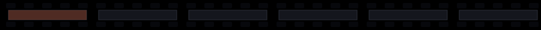
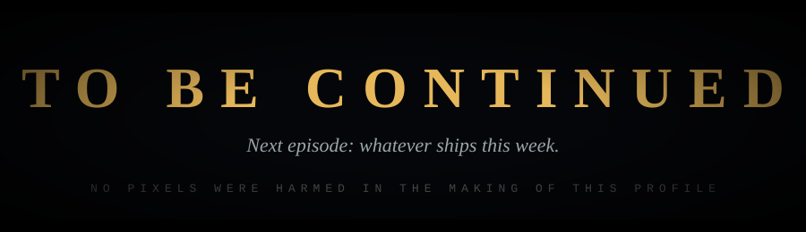

<div align="center">


<br/>

[](https://rabinr.in/)
[](https://www.linkedin.com/in/rabinr)
[](https://rabinr.in/contact)
[](https://github.com/rabinrdev)

</div>




<div align="center">

### *"I engineer Angular products that are still easy to change by the third release."*

</div>

```text
 INT. CHENNAI, INDIA - NIGHT

 A single monitor glows in a dark room. Angular on screen. A cold coffee
 beside the keyboard. A cat, asleep.

                         RABIN
            4+ years. Government immigration systems.
            Pension portals. Insurance consoles. Healthcare
            platforms. Three countries.

                         RABIN (CONT'D)
            Precision. Performance. Accessibility. Scalability.
            That's the whole script.

                                                     SMASH CUT TO:
                                                     PRODUCTION.
```

<table align="center">
<tr>
<td align="center" width="25%"><h2>4+</h2><sub>YEARS IN PRODUCTION</sub></td>
<td align="center" width="25%"><h2>3</h2><sub>COUNTRIES<br/>FIJI / VANUATU / INDIA</sub></td>
<td align="center" width="25%"><h2>6</h2><sub>CASE STUDIES<br/>ON THE PORTFOLIO</sub></td>
<td align="center" width="25%"><h2>100</h2><sub>LIGHTHOUSE<br/>ACCESSIBILITY + SEO</sub></td>
</tr>
</table>




- 🎬 **Lead role:** Frontend Angular Consultant at RSTACK Solutions, building enterprise healthcare apps with **Angular 22, TypeScript, SCSS and Angular Signals**
- 🧱 **Set design:** reusable, scalable UI components on standalone component patterns
- 🔐 **Stunts:** REST API integration with JWT authentication and optimised change detection
- 🎓 **Mentoring the crew:** code reviews and guidance for junior developers
- 📡 **Next casting call:** open to remote and contract work in Angular architecture, performance and migration


<div align="center">

**FRONTEND**


**MOBILE AND BACKEND**


**TOOLS**


<br/>


</div>


<div align="center">

<table>
<tr>
<td align="center" width="33%"><a href="https://github.com/rabinrdev/zelavora-nexus"></a></td>
<td align="center" width="33%"><a href="https://github.com/rabinrdev/zynvora"></a></td>
<td align="center" width="33%"><a href="https://github.com/rabinrdev?tab=repositories"></a></td>
</tr>
</table>

</div>

### 🎞️ FROM THE ARCHIVE: CLIENT WORK (full case studies on the portfolio)

| FEATURE FILM | GENRE | LOGLINE |
| :-- | :-- | :-- |
| [**Fiji Immigration - Internal System**](https://rabinr.in/work/fiji-immigration-internal) | Government Platform | The system immigration officers run a country's borders on |
| [**Fiji Immigration - Citizen Portal**](https://rabinr.in/work/fiji-immigration-external) | Citizen Portal | Visa and permit applications, without the queue |
| [**PRIMS Member Portal**](https://rabinr.in/work/prims-member-portal) | Pension Platform | A pension account members can actually understand |
| [**VNPF blo mi**](https://rabinr.in/work/vnpf-blo-mi) | Mobile App | A provident fund in your pocket, across iOS and Android |
| [**InsureMet**](https://rabinr.in/work/insuremet) | Enterprise Platform | Policies, claims and finance for an insurer, in one console |




<div align="center">


</div>


| ROLE | TECHNOLOGIES | BILLING |
| :-- | :-- | :-- |
| **Frontend Engineering** | Angular 13-22, Standalone, Signals, Zoneless, SSR | Daily, in production |
| **Language** | TypeScript, JavaScript | Daily, in production |
| **Reactive Programming** | RxJS, shared stream patterns | Daily, in production |
| **Mobile** | Ionic, Capacitor, biometrics, offline | Shipped to stores |
| **Backend** | NestJS, REST, JWT, .NET APIs | Working knowledge |
| **Frontend Architecture** | Design systems, component libraries, data flow | Core craft |
| **Performance** | Core Web Vitals, code splitting, Lighthouse | Core craft |
| **Accessibility** | Keyboard, screen readers, varied devices | Core craft |




**🎥 In the editing room**
- Zoneless change detection and incremental migration from Zone.js
- Signals-first state management, starting without a store
- SSR with hydration for public-facing pages

**🎯 Next season's goals**
- Publish more reusable Angular components with live demos and screenshots
- Keep documentation as polished as the code in every pinned repository
- Contribute to open source Angular projects


<div align="center">

### The full feature, with director's commentary:

## [▶ &nbsp; WATCH THE PORTFOLIO &nbsp; ◀](https://rabinr.in/)

[Work](https://rabinr.in/work) &nbsp;|&nbsp; [Services](https://rabinr.in/services) &nbsp;|&nbsp; [Insights](https://rabinr.in/insights) &nbsp;|&nbsp; [About](https://rabinr.in/about) &nbsp;|&nbsp; [Resume](https://rabinr.in/resume)

</div>

**Reading list from the writers' room:**
[Angular Signals for State Management: Start Without a Store](https://rabinr.in/insights/angular-signals-state-management) /
[Angular Zoneless Change Detection: A Practical Migration Guide](https://rabinr.in/insights/angular-zoneless-change-detection) /
[How I Audit an Existing Angular Codebase](https://rabinr.in/insights/angular-codebase-audit)


<div align="center">

[](https://rabinr.in/)
[](https://www.linkedin.com/in/rabinr)
[](https://rabinr.in/contact)

*Usually replies within one business day.*

<br/>



<br/>

⭐ **Enjoyed the show? Star a repo on the way out.** ⭐

</div>
